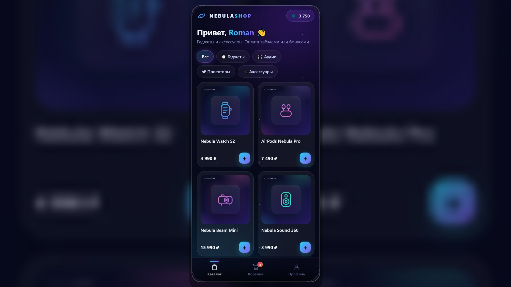
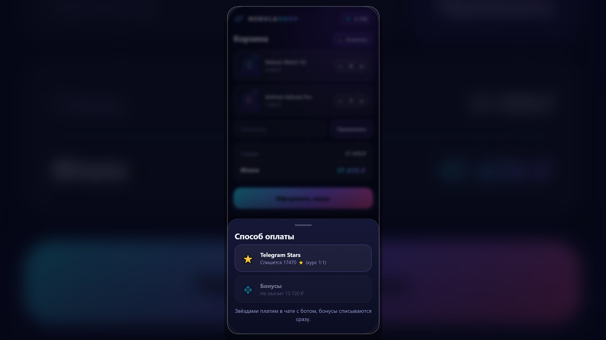
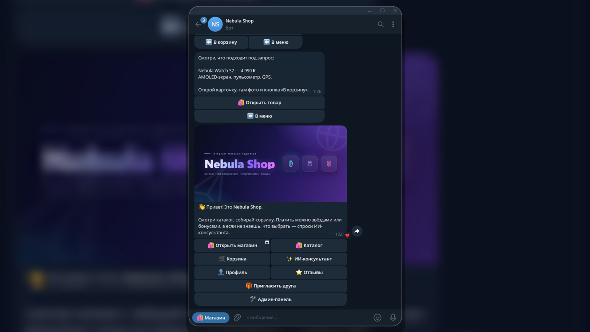
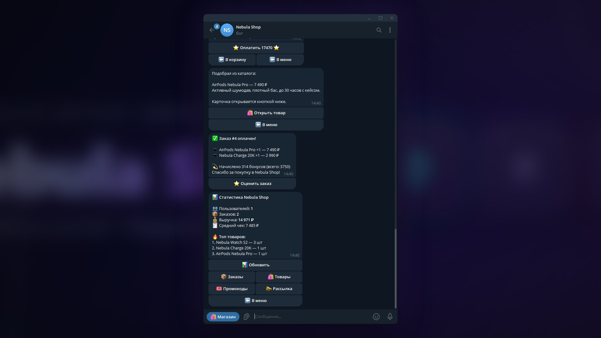

# Nebula Shop — Telegram-магазин гаджетов с ИИ-консультантом

Бот и мини-приложение (Telegram Web App) к нему. Корзина, бонусы и заказы
общие для обоих, оплата звёздами, админка в чате.

## Возможности

**Мини-приложение (Web App)**
- Тёмная витрина: каталог и карточка товара
- Корзина с промокодами и способами оплаты (Stars / бонусы)
- Профиль: бонусный баланс, история заказов, партнёрская ссылка
- Валидация Telegram `initData` (HMAC-подпись) для каждого API-запроса
- Общее состояние с ботом: добавил в приложении — видно и в чате, и наоборот

**Для покупателя (бот)**
- Каталог с категориями, карточками товаров, фото и пагинацией
- Корзина: изменение количества, промокоды, очистка
- Оформление заказа и оплата через Telegram Stars (XTR)
- Оплата бонусными баллами (кешбэк 3% с каждой покупки)
- ИИ-консультант: подбирает товар по запросу словами
- Отзывы с оценкой и комментарием после покупки
- Партнёрская программа: бонусы за приглашённых друзей
- Профиль с историей заказов и статистикой

**Для админа**
- Статистика: пользователи, заказы, выручка, средний чек, топ товаров
- Заказы с деталями
- Товары: добавление с фото, вкл/выкл, смена цены
- Промокоды
- Рассылка по всем пользователям

## Стек

- Python 3.11+ · [aiogram 3](https://docs.aiogram.dev/) (FSM, инлайн-клавиатуры, платежи)
- aiohttp — API и статика Mini App в том же процессе
- SQLAlchemy 2 (async) + SQLite (aiosqlite)
- Фронтенд Mini App: чистый JS + CSS (без сборки и зависимостей)
- FSM-сценарии, middleware сессии БД, фильтры доступа, HMAC-валидация initData

## ИИ-консультант

Работает в двух режимах:
- **С API**: укажи `AI_API_KEY` в `.env` (подойдёт любой OpenAI-совместимый
  сервис). Ответы генерирует LLM, каталог передаётся в промпте.
- **Без ключа**: бот ищет товары по словам из запроса. Для демо этого хватает.

## Структура

```
nebula-shop-bot/
├── main.py                  # точка входа, сборка Dispatcher
├── run.bat / run.sh         # запуск в один клик
├── requirements.txt
├── pyproject.toml           # настройки ruff
├── .env.example
├── LICENSE
├── nebula/
│   ├── config.py
│   ├── filters.py
│   ├── keyboards.py
│   ├── utils.py
│   ├── db/                  # engine + модели SQLAlchemy
│   ├── middlewares/         # сессия БД на каждый апдейт
│   ├── services/            # ИИ-консультант и логика заказов
│   ├── handlers/            # роутеры бота
│   └── webapp/              # aiohttp-сервер Mini App
├── webapp/                  # фронтенд Mini App (HTML/CSS/JS)
├── scripts/
│   ├── seed.py              # демо-данные каталога
│   ├── seed_activity.py     # демо-история заказов и отзывов
│   ├── smoke.py             # быстрая проверка сборки
│   ├── demo_screens.py      # отправка экранов бота в чат (для скриншотов)
│   ├── render_assets.ps1    # генерация картинок (Windows, опционально)
│   └── *.html               # шаблоны для генерации картинок
├── docs/screenshots/
└── assets/
```

## Запуск

Самый простой способ: двойной клик по **`run.bat`** (Windows) или `./run.sh`
(macOS/Linux) — скрипт сам создаст окружение, установит зависимости, попросит
вставить токен и запустит бота.

Вручную:

```powershell
python -m venv .venv
.\.venv\Scripts\python -m pip install -r requirements.txt

Copy-Item .env.example .env
# заполни BOT_TOKEN (от @BotFather) и ADMIN_IDS (узнать ID: @userinfobot)

.\.venv\Scripts\python scripts\seed.py   # демо-данные
.\.venv\Scripts\python main.py           # запуск бота
```

Для macOS/Linux — то же самое:

```bash
python3 -m venv .venv
source .venv/bin/activate
pip install -r requirements.txt
cp .env.example .env
python scripts/seed.py
python main.py
```

Проверка сборки (создаёт базу и проверяет, что все модули импортируются):
`.\.venv\Scripts\python scripts\smoke.py`

По желанию — демо-история заказов и отзывов для профиля:
`.\.venv\Scripts\python scripts\seed_activity.py <твой_telegram_id>`

Миграций нет: при изменении моделей в `nebula/db/models.py` удали файлы
`nebula.db*` (включая `-wal` и `-shm`) — схема пересоздастся при следующем запуске.

## Mini App

Веб-приложение поднимается вместе с ботом на `http://127.0.0.1:8080`
(адрес и порт настраиваются в `.env`).

Если в `WEBAPP_URL` пусто, кнопки «Магазин» внутри Telegram не будет — это
нормально: мини-апп уже работает, но Telegram открывает его только по
публичному HTTPS-адресу. Посмотреть прямо сейчас можно в браузере:

- **В браузере (режим разработки):** включи `WEBAPP_DEV_MODE=1` в `.env`
  и открой `http://127.0.0.1:8080/?dev=<твой_telegram_id>`
- **Внутри Telegram** нужен публичный HTTPS-адрес. Быстрый способ:
  1. Установи [cloudflared](https://developers.cloudflare.com/cloudflare-one/connections/connect-networks/downloads/)
  2. Запусти: `cloudflared tunnel --url http://127.0.0.1:8080`
  3. Полученный `https://...trycloudflare.com` впиши в `WEBAPP_URL` в `.env`
  4. Перезапусти бота — появится кнопка «Магазин» (меню-кнопка) и кнопка
     «🛍 Открыть магазин» в главном меню

Для продакшена: замени `MemoryStorage` на персистентное FSM-хранилище
(Redis или SQLite) — состояния диалогов переживут перезапуск бота. Учти, что
кэш экранов и пользовательские блокировки живут в памяти процесса: для
нескольких воркеров нужен общий стор.

## Демо-данные

- Категории: Гаджеты, Аудио, Проекторы, Аксессуары
- 6 товаров с карточками (`assets/products/`)
- Промокоды: `NEBULA10` (−10%), `WELCOME5` (−5%)

Проект демонстрационный: витрина, корзина и оплата настоящие, а склад, доставка
и трекинг — под конкретный магазин.

## Скриншоты

Mini App:




Бот:




Полный набор — в `docs/screenshots/`. Пересъёмка Mini App: запусти бота и
открой `scripts/shot.html?src=<url приложения>` в headless-браузере;
экраны бота — `scripts/demo_screens.py <screen> <chat_id>`.

## Лицензия

MIT — см. [LICENSE](LICENSE).
